# DESIGN — Support Ticket Triage Pipeline

> How the system is built and why. For exact schemas, rules and acceptance criteria see [SPEC.md](SPEC.md).

## TL;DR

- **What it is:** a batch CLI pipeline (`python run_pipeline.py`) that reads `tickets.json` + `kb_articles.json` from disk and regenerates every artifact from scratch: retrieval → classification → drafting → escalation → validation.
- **Deterministic where it can be, LLM only where it must be.** PII masking, escalation (rules engine), safety filtering, grounding checks and validation are pure Python and reproducible. Retrieval uses OpenAI embeddings (masked text only), made reproducible by a content-addressed vector cache, with offline TF-IDF as a fallback mode. The LLM is used for exactly two stages: **classification** and **drafting**.
- **A stage machine enforces order in code.** `INIT → … → RESULTS_FINALISED`. A stage can't run unless the previous one finished and its artifact is on disk. Drafting can't run before retrieval and classification.
- **PII never reaches an LLM.** A deterministic detector masks emails, phones, cards (Luhn), IBANs (mod-97) and disclosed credentials in `TICKETS_NORMALISED`. Prompts only contain `[TYPE_n]` placeholders, and the validator checks drafts, reasons and logs for leakage.
- **Every LLM output is untrusted until validated.** The model is asked for structured JSON, the output is parsed with Pydantic models built from the code-defined taxonomy, checked against business rules (citations ⊆ retrieved, no password requests, no refund promises), and retried with error feedback or replaced with a safe fallback.
- **Easy to inspect:** one JSON artifact per stage, `llm_calls.jsonl` with a prompt hash per call, `retrieval_debug.json` explaining rankings, `grounding_flags.json` for unsupported claims, and `run_manifest.json` recording stage timings and input hashes.
- **Provider-agnostic:** one OpenAI-compatible client works with **Ollama Cloud** (`glm-5.2`, default) and **OpenAI** (`gpt-6.1-sol`), plus an offline `stub` provider for tests and CI.
- **Replayable:** content-addressed caches (retrieval keyed by ticket+KB hash, LLM keyed by prompt hash) let a rerun with a changed `tickets.json` recompute only the changed tickets.
- **Delivered and evaluated in audited stages:** [PLAN.md](PLAN.md) defines five human-signed stages, each closed with a commit and tag. Models are compared by an offline eval harness (`evals/`), outside the pipeline (§13).

---

## 1. Goals and non-goals

| Goals | Non-goals |
|---|---|
| Rerun from a clean checkout with replaced inputs | Real-time / streaming ticket intake |
| Grounded answers: only KB content, only retrieved articles cited | Sending replies to customers |
| Taxonomy enforced in code, not just in the prompt | Training or fine-tuning models |
| Stage order enforced in code | A web UI |
| Every decision traceable to inputs, evidence and prompts | Multi-tenant or distributed execution |
| Customer PII never sent to an LLM or written to artifacts/logs | Anonymisation guarantees beyond the documented PII types |
| Safe degradation: bad LLM output never reaches artifacts unvalidated | Perfect classification accuracy |

---

## 2. System context

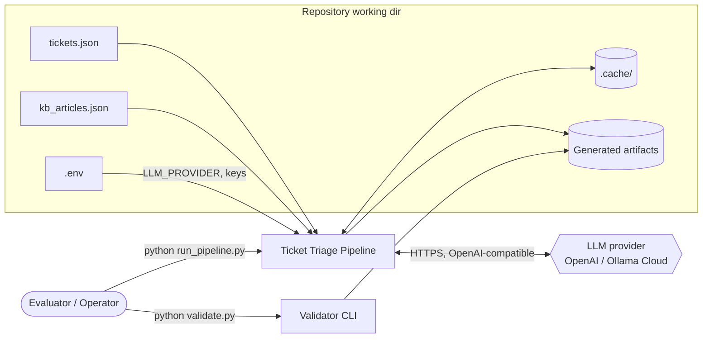

- The pipeline's only external dependency is the LLM provider. Everything else is local files.
- `validate.py` runs on its own, so it can check artifacts that some other process produced.

---

## 3. Architecture overview

### 3.1 Component diagram

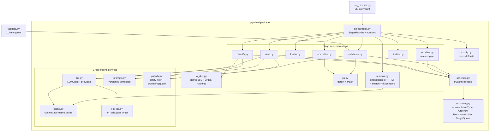

### 3.2 Responsibilities at a glance

| Module | Responsibility | Deterministic? |
|---|---|---|
| `orchestrator.py` | Owns the `Stage` enum, enforces transitions, runs stages, writes `run_manifest.json` | ✅ |
| `config.py` | Reads `.env` / env vars, provider + model selection, thresholds | ✅ |
| `taxonomy.py` | Single source of truth for allowed labels (Python `StrEnum`s) | ✅ |
| `schemas.py` | Pydantic models for every input and artifact; `extra="forbid"` | ✅ |
| `loader.py` | Reads and structurally validates the two input files | ✅ |
| `normalise.py` | Cleans tickets (whitespace, NFC, language default, dedupe, truncation), then calls `pii.py` | ✅ |
| `pii.py` | PII detection (email, phone, Luhn card, mod-97 IBAN, credential), stable masking, `unmask`, leakage scan used by the validator | ✅ |
| `retrieval.py` | Embeds KB + tickets (cached, masked text only) or builds the TF-IDF index; top-3 search, score threshold, debug terms + snippets | ✅ given the vector cache |
| `cache.py` | Content-addressed JSON cache (embedding vectors, per-ticket retrieval results) | ✅ |
| `classify.py` | Builds the prompt, calls the LLM, validates and retries, falls back | ❌ (LLM) |
| `draft.py` | Builds the grounded prompt, calls the LLM, runs safety/citation checks, retries, falls back | ❌ (LLM) |
| `escalate.py` | Rules engine: classification + KB evidence → escalate/queue/reason | ✅ |
| `guards.py` | Safety patterns S1–S3 (credential request, refund promise, escalation mention), credential-advice check, PII/placeholder checks | ✅ |
| `grounding.py` | Grounding guard G1–G3: flags numbers, UI paths and commitments in a draft that its cited KB text doesn't support | ✅ |
| `language.py` | Stopword language heuristic for en/es/fr/de/pt (V09, drafting eval) | ✅ |
| `validation.py` | Cross-artifact checks → `validation_report.json` | ✅ |
| `llm.py` | Provider abstraction (OpenAI, Ollama, stub), per-provider parameter adapter, timeouts, retries, JSON mode | — |
| `cache.py` | Content-addressed read/write under `.cache/` | ✅ |
| `llm_log.py` | Appends one JSON line per LLM call to `llm_calls.jsonl` | ✅ |

---

## 4. Pipeline stages and control flow

### 4.1 State machine

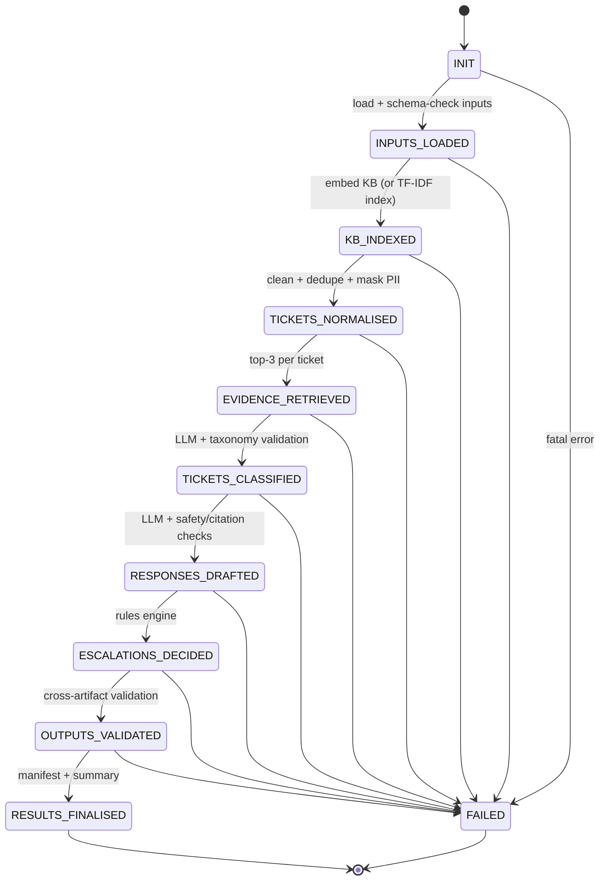

**How order is enforced in code**

- `Stage` is an ordered `IntEnum`. `StageMachine.advance(to)` raises `StageOrderError` unless `to == current + 1`.
- Every stage function is registered with `@stage(Stage.X, requires=[...artifacts])`. Before it runs, the orchestrator checks that the machine is at `X − 1` and that each required artifact exists and parses.
- Stages receive their inputs **as typed objects returned by earlier stages**, not as globals, so drafting physically can't run without `RetrievalResult` and `Classification` objects.
- `FAILED` covers *fatal* errors only (unreadable input, empty KB file with invalid structure, an artifact write error). Per-ticket LLM failures are **not** fatal: they fall back and get flagged.

### 4.2 End-to-end sequence

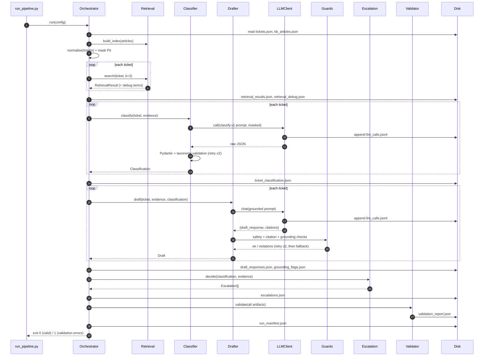

---

## 5. Data flow and artifacts

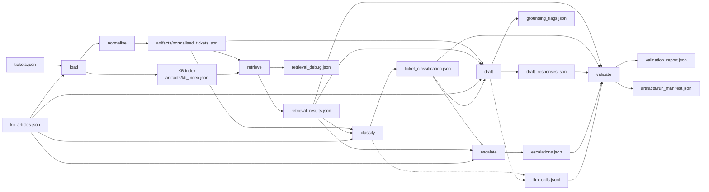

- **Required artifacts** are written to the repo root (where the evaluator looks).
- **Intermediate artifacts** (`kb_index.json`, `normalised_tickets.json`, `run_manifest.json`) go to `artifacts/`.
- All writes are **atomic** (write to `*.tmp`, then `os.replace`), so a crash never leaves half-written JSON.
- Every artifact is **ordered by input ticket order** and includes every ticket, including ones that failed and fell back.

---

## 6. Component design

### 6.1 Loading and normalisation

- `loader.py` parses JSON and validates it against `TicketsFile` / `KBFile` Pydantic models. Unknown extra fields are **kept** (forward-compatible inputs) but ignored.
- `normalise.py`, deterministically and per ticket:
  - Unicode NFC, collapse whitespace, strip control characters.
  - `language`: lowercase, BCP-47 primary subtag (`en-GB → en`). Missing → `en` with a `normalisation_note`.
  - `customer_tier`: lowercase; unknown values are kept but flagged.
  - Empty `subject` **and** `message` → marked `insufficient_content=true`, so classification is steered to `request_more_info`.
  - Message truncated to `MAX_TICKET_CHARS` (default 4000), with a note.
  - Duplicate `ticket_id`: the first occurrence wins and later ones are logged in the manifest. Output keys must be unique.
  - PII detection and masking (§6.11) runs last, so every later stage only sees masked text.
- Normalisation never changes meaning. It only exists to make the next stages robust. It is idempotent: `normalise(normalise(x)) == normalise(x)`.

### 6.2 Retrieval (embeddings, cached; TF-IDF offline)

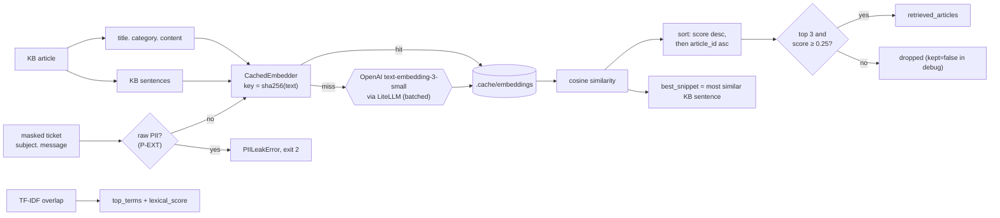

- **Why embeddings (decision OD-2):** the eval set has es/fr/de/pt tickets and an English KB. Lexical retrieval can't bridge languages: TF-IDF found a relevant article for only 2 of 4 non-English tickets. `text-embedding-3-small` found one for 4/4, kept 16/16 English recall, MRR 1.0, and returned `[]` for all three no-match tickets (Stage 2 audit). PROBLEM.md explicitly allows embeddings.
- **Reproducibility:** the embeddings API is not bit-for-bit deterministic. A fresh re-embedding drifted scores by up to 0.0011, with the same top 3 for 23/23 tickets. So every vector is cached by `sha256(text)` per model: reruns are byte-identical and make no API calls. A clean checkout re-embeds once; the threshold sits about 40× the observed drift away from the nearest score.
- **PII:** only masked text is embedded. `CachedEmbedder` runs the PII detector on every text and refuses to send one with a hit (P-EXT), so masking can't be bypassed even by a bug upstream.
- **Cost and latency:** three API calls per cold run (all articles, all KB sentences, all ticket queries, each batched). Zero calls on a warm rerun. Per-ticket results are also cached (R1), so a changed `tickets.json` only re-embeds the changed tickets.
- **Explainability:** a vector score explains nothing on its own, so the debug artifact adds the KB sentence most similar to the ticket (`best_snippet`), plus the TF-IDF lexical overlap (`top_terms`, `lexical_score`). Non-English tickets usually show no lexical overlap, which is itself the explanation for using embeddings.
- **Threshold:** `0.25`, chosen by the Stage 2 sweep. Every value in [0.20, 0.35] was perfect on the eval set; 0.25 leaves margin above the highest no-match score (~0.21) and below the lowest relevant top-1 (~0.39). It also keeps useful secondary evidence such as KB-004 for T-1001. A ticket can end up with **0–3** articles; an empty list is valid and handled downstream (C3).
- **Offline mode (`--retriever tfidf`, default with `--provider stub`):** pure-Python TF-IDF (unigrams + bigrams, sublinear tf, smoothed idf, L2 norm; title ×3, category ×2, subject ×2; light stemming so charge/charges/charged match). No network, used by the test suite. Threshold `0.05`.
- **Failures:** a missing `OPENAI_API_KEY` stops the run before any stage (exit 2, suggesting `--retriever tfidf`). An API failure after LiteLLM's 3 retries raises `EmbeddingError` (exit 2). Retrieval never silently falls back to TF-IDF, because results would differ by environment.

### 6.3 LLM client

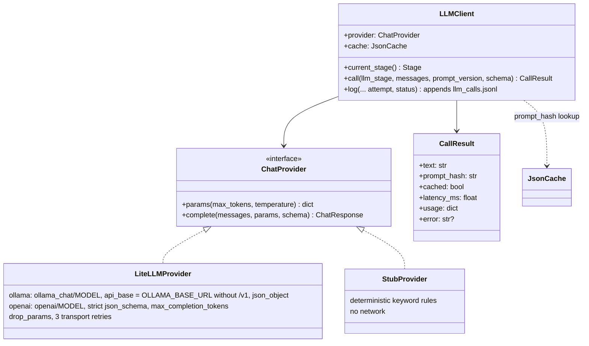

- **One provider layer: LiteLLM.** Ollama Cloud models go through `ollama_chat/<model>` (that route returns clean JSON, while Ollama's OpenAI-compatible route wrapped JSON in markdown fences). OpenAI models go through `openai/<model>`. Keys are read from the environment by LiteLLM and never stored in config or artifacts. `litellm.drop_params` removes parameters a model rejects (some reasoning models reject `temperature`/`seed`).
- **Parameters:** `temperature=0`, `seed=42` (where supported), a token limit large enough for reasoning models (default 1500), 60 s timeout. The adapter sends it as `max_completion_tokens` to OpenAI and `max_tokens` to Ollama. Model IDs accept a `:cloud` suffix (Ollama CLI convention), which is stripped.
- **Models:** the pipeline default is `ollama` / `glm-5.2`; `openai` / `gpt-6.1-sol` is selectable. Evals always use two other models (§13), so the system is never graded by the model it was tuned on.
- **Structured output:** OpenAI gets a strict `json_schema` built from the taxonomy enums. Ollama gets `json_object`, with the same schema spelled out in the system prompt. Markdown fences are stripped defensively. Either way, the **Pydantic validation in our code is the real gate**.
- **Guards inside the client:** the call is refused (programming error, exit 2) when the running stage isn't the one allowed for that kind of call (O3: classification only in `TICKETS_CLASSIFIED`, drafting only in `RESPONSES_DRAFTED`), and when any message contains raw PII (P-LLM).
- **Transport vs content retries:** LiteLLM retries 429/5xx/timeouts 3 times. If it still fails, the client returns a `transport_error` result instead of raising, and the classifier spends one of its 3 attempts on it, retrying the same prompt. Content failures (bad JSON, schema, wrong `ticket_id`) retry with the errors fed back (§6.4).
- **`prompt_hash`** = `sha256(canonical_json({provider, model, params, prompt_version, messages}))`. It's the LLM cache key and the log's link to the exact prompt. `llm_trace_sample.md` (Stage 3 audit) shows the hash being recomputed from re-built prompts.
- **Cache:** results are stored by prompt hash (transport errors never are). A warm rerun makes no LLM calls and logs `cached: true`. The eval harness gives each (model, repeat) its own cache namespace so repeats are real calls.
- **`StubProvider`:** a keyword-rule classifier, so the pipeline and test suite run offline. It's selected with `LLM_PROVIDER=stub`, and its log entries say `provider: "stub"`. It is not a quality baseline.

### 6.4 Classification

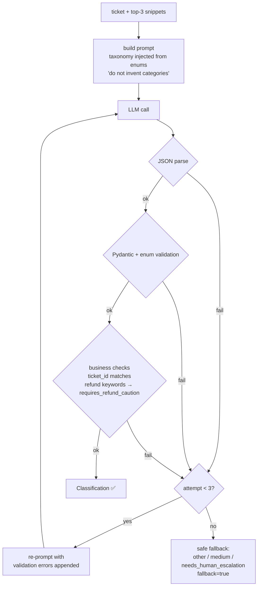

- **Prompt contents (required by the brief):** ticket fields, retrieved article snippets (`article_id`, title, category, content), the allowed values for every field (rendered from `taxonomy.py`, so prompt and validator can never drift), and an explicit "use only these values; do not invent categories" instruction.
- **Prompt-injection hygiene:** ticket text goes inside clearly delimited `<ticket>` tags, with an instruction to treat it as data.
- **Masked input only:** the ticket text in the prompt is the masked text from `normalised_tickets.json` (§6.11).
- **Deterministic post-rules (code overrides the model):**
  - The refund/charge lexicon in the **ticket** (en/es/fr/de/pt) forces `requires_refund_caution=true` (C1). Evidence isn't scanned: retrieval keeps loosely related articles, such as the refund-policy article next to an invoice question, which would wrongly force the flag.
  - `insufficient_content` forces `resolution_action=request_more_info`, unless the model escalates.
  - With zero retrieved articles, `answer_from_kb` is downgraded to `needs_human_escalation`, because nothing grounds the answer.
  - A disclosed credential (C5) forces `customer_sensitive=true`.
- Overrides are recorded in the record's `rationale` suffix and in the manifest, so they stay visible.

### 6.5 Grounded drafting

- **Inputs:** normalised ticket, the **full text of retrieved articles only**, and the validated classification. The model never sees the rest of the KB.
- **Prompt rules:** answer in `ticket.language`; use only facts from the provided articles; cite the `article_id`s used; don't promise refunds, timelines or actions the KB doesn't state; never ask for passwords, card numbers, CVV or OTP codes; never repeat personal data, and refer to it generically ("the email address you provided") because the model only sees placeholders; if `resolution_action == needs_human_escalation`, say the ticket is being escalated to the relevant team; if `request_more_info`, ask only for safe details (order ID, date, screenshot).
- **Output:** `{"draft_response": str, "citations": [article_id]}`.
- **Post-checks, run by `guards.py` after each attempt:**
  1. `citations ⊆ retrieved_ids`. Invalid IDs are a violation (they're not silently dropped).
  2. Safety filter: regex patterns for credential requests in multiple languages (SPEC §7.4).
  3. Refund-promise detector, when `requires_refund_caution` is set.
  4. Escalation mention present when required.
  5. Non-empty, length ≤ `MAX_DRAFT_CHARS`.
  6. No raw PII and no `[TYPE_n]` placeholders (V13/V14 logic from `pii.py`).
  7. When a credential disclosure was detected (C5), the "never share your password" advice is present.
- If a check fails, the drafter re-prompts with the violations (up to 2 retries; a rejected reply that contains PII is withheld from the retry prompt, never echoed). After that it uses a **deterministic fallback template** in the ticket language (en default) that acknowledges the issue, states escalation, and cites nothing beyond what was retrieved. It's marked `fallback=true`.
- The **grounding guard** (§6.8) runs on the accepted draft and writes flags. It doesn't block, because it's a heuristic, but flags appear in the validation report.

### 6.6 Escalation rules engine (deterministic)

The escalation decision is **not** an LLM call. It's a pure function of the classification and the retrieved evidence, so it's auditable and reproducible.

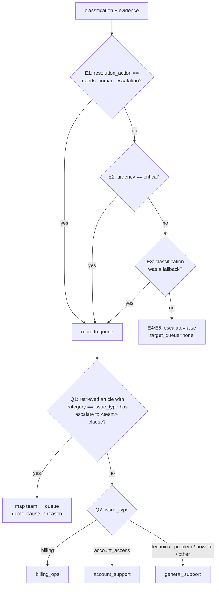

- **Split of responsibilities:** the *whether* comes from the validated classification. Its prompt includes each retrieved article's escalation conditions, and C3 forces escalation when there's no evidence. The *where* and *why* come from the KB evidence. Word-overlap matching of KB conditions against ticket text was rejected because it's fragile: "two charges… order" falsely matches KB-001's "two *settled* charges" condition.
- **KB-driven routing (Q1):** retrieved article content is scanned for `escalate to <team>` phrases, and team names map to queues (`billing ops|billing support → billing_ops`, `account support → account_support`). The clause is quoted in `reason`, which grounds the decision in retrieved evidence.
- **Built-in rules from the brief:**
  - Login failure after a successful reset → the classifier is guided to `needs_human_escalation` by KB-002's condition, and Q1 routes it to `account_support`.
  - Duplicate charge / refund → if escalated, the reason must use non-committal wording ("verify settlement status"), never "refund due". This is enforced by the refund-promise detector on `reason` (SPEC E-INV3).
- **PII-safe reasons:** a `reason` never contains PII or placeholders (SPEC E-INV4).
- **Invariant:** `escalate=false ⇔ target_queue="none"`. It's enforced by a Pydantic `model_validator` and checked again by the validator.
- Every `reason` cites the rule ID that fired (e.g. `R1:classification_requires_escalation`, `R2:kb_escalation_condition[KB-002]`) for traceability.

### 6.7 Safety filter

- Multilingual regex lexicon (en, es, fr, de, pt plus a generic fallback) for:
  - credential requests: `(send|share|provide|tell|confirm) … (password|passcode|PIN|OTP|2FA code|CVV|card number)`
  - refund guarantees: `(we will|we'll|you will) … refund`, `refund (has been|is) (issued|processed|approved)`, `guarantee … refund`
- The same lexicon is used by `draft.py` (to block) and by `validation.py` (to verify), so there's one source of truth.
- "Never share your password" is **allowed**. Negation-aware patterns check for `never|do not|don't` before the verb, which avoids false positives on the KB's own advice.

### 6.8 Grounding (hallucination) guard

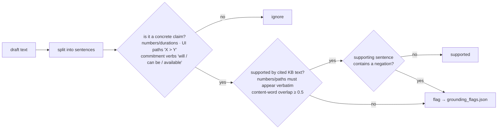

- A simple heuristic, as the brief allows. It flags rather than blocks, and every flag records the sentence, the claim type, the cited articles checked, and the overlap score.
- **Negation rule:** a KB sentence containing a negation ("should not be promised") never counts as support for a commitment, so "refunds can be issued" is not backed by "refunds should not be promised".
- Example: "Your pending charge will disappear within 24 hours" is flagged, because `24 hours` isn't in KB-001, which says "3-5 business days".

### 6.9 Validation

- `validation.py` is a library used by both the `OUTPUTS_VALIDATED` stage and the standalone `validate.py` CLI.
- It's **independent of in-memory state**: it re-reads everything from disk, so it validates what was actually written. V13 runs the PII detector over drafts, reasons and `llm_calls.jsonl`; V14 rejects placeholders in drafts and reasons.
- Each check has a stable ID (`V01`…`V14`, see SPEC §8) with a `pass`/`fail`/`warn` status and per-ticket details, so failures can be acted on.
- Exit code: `0` if there are no `fail`s, `1` otherwise. `warn`s (e.g. grounding flags) don't fail the run.

### 6.10 Caching and replayability (stretch)

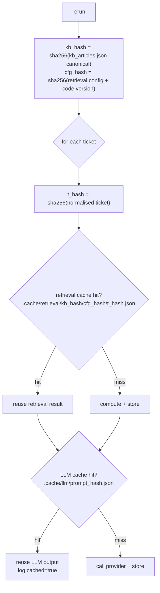

- The cache is **content-addressed**: changing a ticket's text, the KB, the prompt template version or the model changes the key, so stale results can't leak.
- The KB index is rebuilt on every run because it's cheap (milliseconds). Only per-ticket results are cached.
- `--no-cache` forces a full recompute. `.cache/` is git-ignored, so a clean checkout always recomputes.
- **Artifacts are always fully rewritten**, cache or not, so outputs reflect exactly the current inputs.

### 6.11 PII protection

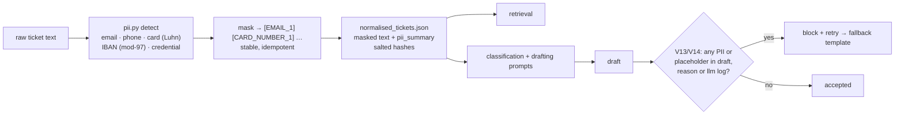

- **Where:** inside `TICKETS_NORMALISED`, so the raw text exists only in the loaded input and in memory. Nothing downstream ever reads it.
- **Detection is deterministic** and tuned against `data/fixtures/pii_cases.json`, including false-positive guards (order IDs, dates, amounts, error codes, Luhn-/mod-97-invalid digit runs).
- **`unmask` is test-only.** The placeholder → value map is held in memory during the stage and not persisted, so `unmask(mask(x)) == x` is provable without a stored secret.
- **Credentials:** a disclosed password/PIN/OTP triggers C5 (`customer_sensitive=true`) and the drafter must include the "never share your password" advice.
- **Logs:** `llm_calls.jsonl` stores hashes, not prompts. `--log-prompts` writes masked prompts only.
- **Outputs:** drafts refer to PII generically; placeholders are blocked because they would look broken to a customer.

---

## 7. Error handling strategy

| Failure | Scope | Behaviour |
|---|---|---|
| Input file missing / invalid JSON / wrong top-level shape | Fatal | `FAILED`, clear message, exit 2 |
| Individual ticket malformed (missing `ticket_id`) | Ticket | skipped, recorded in manifest `rejected_tickets` |
| No KB articles at all | Run | allowed: every retrieval is empty → escalations follow the rules |
| Retrieval finds nothing | Ticket | `retrieved_articles: []`, draft cites nothing, `answer_from_kb` disallowed |
| LLM transport error (429/5xx/timeout) | Call | backoff retry ×3, then treated as content failure |
| LLM returns invalid JSON / taxonomy / unsafe text | Ticket | content retry ×2 with error feedback, then safe fallback `fallback=true` |
| Missing API key | Run | fatal, unless `LLM_PROVIDER=stub` |
| Artifact write error | Fatal | `FAILED` (atomic writes keep previous files intact) |

---

## 8. Observability

- **`llm_calls.jsonl`:** one line per call, with the required fields plus `attempt`, `cached`, `latency_ms`, `status`, `prompt_version` and `ticket_ids`. Prompts aren't stored inline (only the hash). With `--log-prompts`, full **masked** prompts go to `artifacts/prompts/{prompt_hash}.json` for debugging.
- **`run_manifest.json`:** run ID, start/end timestamps, per-stage duration, input file hashes, provider/model, counts (tickets, fallbacks, overrides, cache hits, flags, PII detections by type), and the final stage reached.
- **Console:** a one-line progress line per stage and a final summary table.

---

## 9. Technology choices

| Concern | Choice | Why |
|---|---|---|
| Language | Python 3.11+ (dev on 3.14) | Preferred by the brief; `StrEnum`, modern typing |
| Schemas | Pydantic v2 | Strict validation, JSON Schema generation for structured output |
| Retrieval | OpenAI `text-embedding-3-small` via LiteLLM (+ pure-Python TF-IDF offline mode) | Cross-lingual; reproducible through the vector cache; TF-IDF keeps tests offline with no extra dependency |
| Provider layer | LiteLLM | One client for OpenAI and Ollama models (embeddings now; LLM calls in Stage 3) |
| LLM SDK | LiteLLM (`ollama_chat/`, `openai/` routes) | One client for Ollama Cloud and OpenAI, with retries and param dropping |
| Default model | `glm-5.2` (Ollama Cloud) | Verified working; set by `LLM_PROVIDER=ollama` (default) |
| Fast dev model | `glm-5.3-flash` (Ollama Cloud) | Substitute for the non-existent `glm-5.2-flash` |
| Alt / eval model A | `gpt-6.1-sol` (OpenAI) | Verified working; needs `max_completion_tokens`; `LLM_PROVIDER=openai` |
| Eval model B | `deepseek-v4.1-flash` (Ollama Cloud) | Verified working; used by the eval harness |
| PII | stdlib `re` + Luhn / mod-97 checks | Deterministic, no model download |
| Config | `python-dotenv` | Reads `.env`, which isn't committed |
| Tests | `pytest` + `StubProvider` | Offline, deterministic CI |

---

## 10. Repository layout

```text
ticket-classification/
├── run_pipeline.py            # CLI: full run
├── validate.py                # CLI: standalone validation
├── pipeline/
│   ├── orchestrator.py        # Stage enum, StageMachine, Pipeline run loop, manifest builder
│   ├── stages.py              # stage functions + registry (unbuilt stages are placeholders)
│   ├── runner.py              # runs the pipeline, maps errors to exit codes, always writes the manifest
│   ├── config.py
│   ├── taxonomy.py
│   ├── schemas.py
│   ├── io_utils.py
│   ├── loader.py
│   ├── normalise.py
│   ├── pii.py
│   ├── retrieval.py
│   ├── llm.py
│   ├── llm_log.py
│   ├── prompts.py
│   ├── classify.py
│   ├── draft.py
│   ├── escalate.py
│   ├── guards.py
│   ├── grounding.py
│   ├── language.py
│   ├── validation.py
│   ├── cache.py
│   ├── finalise.py
├── tests/                     # unit + end-to-end (stub provider), markers stage1…stage5
├── evals/                     # offline eval harness (never run by run_pipeline.py)
├── scripts/                   # audit_stage<N>.py: runs a stage's AI audit, writes audit/stage-N/
├── data/                      # eval set, gold labels, fixtures (see data/README.md)
├── audit/                     # per-stage audit reports, FINAL_REPORT.md (committed)
├── tickets.json               # input
├── kb_articles.json           # input
├── retrieval_results.json     # ┐
├── retrieval_debug.json       # │
├── ticket_classification.json # │ generated at repo root
├── draft_responses.json       # │ (required artifacts)
├── grounding_flags.json       # │
├── escalations.json           # │
├── validation_report.json     # │
├── llm_calls.jsonl            # ┘
├── artifacts/                 # intermediate artifacts + manifest
├── .cache/                    # replay cache (git-ignored)
├── requirements.txt           # runtime deps · requirements-dev.txt adds pytest/pytest-cov
├── pytest.ini
├── README.md · DESIGN.md · SPEC.md · PLAN.md · PROBLEM.md
└── .env                       # API keys (git-ignored)
```

---

## 11. Key design decisions and trade-offs

| # | Decision | Alternative | Rationale |
|---|---|---|---|
| D1 | Escalation via a deterministic rules engine | LLM decides escalation | Brief requires grounding in classification + evidence; rules are auditable and reproducible |
| D2 | Embedding retrieval (OpenAI, cached), TF-IDF offline mode | TF-IDF only | Only embeddings handle non-English tickets (4/4 vs 2/4); the cache restores reproducibility; TF-IDF keeps tests offline |
| D3 | One LLM call per ticket per stage | Batch calls | Simple per-ticket validation, retry and traceability; ticket counts are small |
| D4 | Code-level overrides of LLM fields | Trust the model | Safety-critical flags (refund caution, no-evidence) shouldn't depend on model compliance |
| D5 | Grounding guard flags, doesn't block | Block on any flag | Heuristic has false positives; blocking would cause needless fallbacks |
| D6 | Validator re-reads from disk | Validate in-memory objects | Proves the *written* artifacts are correct; usable standalone |
| D7 | Safe fallback instead of crashing | Fail the run | Every ticket must appear in every artifact; fallbacks are explicit and counted |
| D8 | Taxonomy rendered into prompts from enums | Hard-coded prompt text | Prompt and validator can never disagree |
| D9 | Mask PII before any LLM or retrieval sees it | Redact only in outputs / trust the provider | Raw PII then exists nowhere downstream; leakage becomes checkable |
| D10 | No silent fallback from embeddings to TF-IDF | Fall back on API failure | Results would depend on network health; a fatal, clear error is easier to audit |
| D11 | Evals use two models different from the dev model, cross-judged, offline | Grade with the dev model / run evals in the pipeline | Avoids self-preference and tuning on the grader; keeps the pipeline run deterministic and cheap |

---

## 12. Risks and mitigations

| Risk | Mitigation |
|---|---|
| Model ignores the taxonomy or invents a category | Strict schema + Pydantic enums + retry with errors + fallback |
| Model promises refunds or asks for passwords | Prompt rules + regex guards + retry + template fallback + validator check |
| Model cites a non-retrieved article | Citation subset check blocks the draft; validator re-checks |
| Replaced inputs with different languages | Language-aware prompts; multilingual safety lexicon; template fallback |
| Prompt injection inside ticket text | Delimited data blocks; deterministic guards run regardless of model output |
| PII sent to a provider or leaked into drafts/logs | Deterministic masking before retrieval and prompts; V13/V14 validation; hashes instead of prompts in logs |
| PII detector misses a format or over-masks (order IDs, amounts) | Fixture-driven tests incl. false-positive guards; the Stage 1 human audit reviews the masking report |
| Non-English ticket matches nothing in an English KB | Multilingual embeddings (4/4 in the eval); C3 escalates when still empty |
| Embedding API drift or outage | Vector cache (byte-identical reruns); wide threshold margin; fatal `EmbeddingError` instead of a silent fallback |
| Ticket text sent to a third party | Only PII-masked text is embedded; `CachedEmbedder` refuses raw PII (P-EXT) |
| Provider outage / rate limits | Backoff retries; cache; `stub` provider for offline runs |
| Non-determinism between runs | `temperature=0`, seed, cache; deterministic stages around the LLM |

---

## 13. Evaluation and delivery

The pipeline itself never evaluates models. Evaluation is offline tooling in `evals/`, driven by the staged plan in [PLAN.md](PLAN.md).

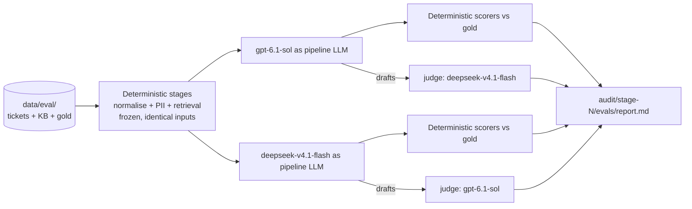

- **Same frozen inputs for both models**, so differences come from the model alone. Results are cached by prompt hash.
- **Cross-judging** avoids self-preference. Judge authority is gated on human calibration (SPEC EV6).
- **Stages 0–5** each have AI gates (`pytest -m stageN` plus evals) and a human audit. A stage is closed only by a human sign-off, followed by a commit and an annotated tag `stage-N-closed` containing the stage's code and `audit/stage-N/` reports.
- The dev model (`glm-5.2`) numbers are reported for information only.
