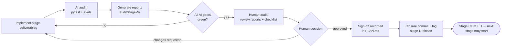
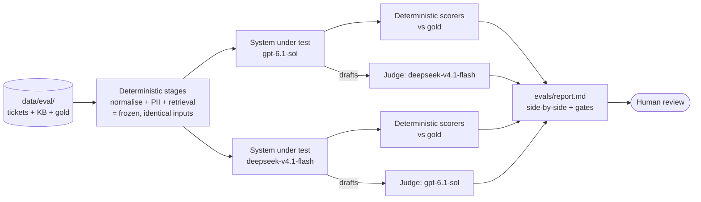

# PLAN — Delivery in 5 audited stages

> Builds the system described in [DESIGN.md](DESIGN.md) / [SPEC.md](SPEC.md) for the brief in [PROBLEM.md](PROBLEM.md). Test and eval data is in [`data/`](data/README.md).

## TL;DR

- **Five stages**, each with a goal, deliverables, exit criteria, an **AI audit** (deterministic `pytest` + evals for anything non-deterministic) and a **human audit** (review the generated reports, then sign off).
- **A stage is closed only when a human signs it off.** The AI agent can run audits and tick AI boxes, but must never tick human boxes or mark a stage `Closed`. The next stage starts only after the previous one is closed.
- **Every stage closure ends in a git commit** (and an annotated tag) that contains the stage's code, its `audit/stage-N/` reports and the recorded sign-off. The commit is made only after the human sign-off (§1, step 6).
- **Determinism first:** only **classification** and **drafting** call an LLM in the pipeline. Loading, normalisation, PII masking, retrieval, escalation, safety, grounding and validation are pure Python and fully covered by `pytest`.
- **Every LLM component gets a 2-model eval:** `gpt-6.1-sol` (OpenAI) and `deepseek-v4.1-flash` (Ollama Cloud) both run on the same frozen inputs, are scored deterministically against `data/eval/gold.json`, and are **cross-judged** (each model judges the other's drafts) where a rubric is needed.
- **Cross-cutting guarantees** (auditability, explainability, idempotency, PII) are built into specific stages and tested there (§3).
- **Stage 5 closes the project:** clean-checkout run, swapped inputs, replay, final 2-model E2E eval, README, and the closing sign-off.

| Stage | Name | LLM? | Evals | Status |
|---|---|---|---|---|
| 0 | Plan approval (this document + data files) | — | — | ☑ Closed (2026-10-20) |
| 1 | Foundations: config, schemas, loading, normalisation, **PII**, stage machine | No | — (deterministic only) | ☑ Closed (2026-10-20) |
| 2 | Retrieval & evidence | No | Deterministic retrieval eval | ☐ Open |
| 3 | LLM layer & classification | **Yes** | 2-model classification eval | ☐ Open |
| 4 | Drafting, guards, grounding & escalation | **Yes** (drafting) | 2-model drafting eval + cross-judging | ☐ Open |
| 5 | Validation, orchestration, replay & **project closure** | Yes (E2E) | 2-model full-pipeline eval | ☐ Open |

---

## 1. Closure protocol (applies to every stage)

1. **Implement** only the deliverables of the current stage.
2. **AI audit:** run `pytest -m stageN` (and all earlier markers, as a regression check) plus the stage's evals. Every run writes to `audit/stage-N/`:
   - `pytest.xml` (JUnit), `coverage.txt`, `pytest_summary.md`
   - `evals/<model>/results.jsonl` + `evals/report.md` (LLM stages)
   - stage-specific human-review reports (listed per stage)
   - `AUDIT_SUMMARY.md`: gates table (metric, threshold, value, ✅/❌), known issues, and the git SHA / input hashes
3. **Gates:** **hard gates** must pass for both eval models. **Soft gates** may miss, but only with a written justification in `AUDIT_SUMMARY.md`.
4. **Human audit:** the reviewer reads the listed reports, works through the checklist, and fills in the sign-off block. Possible outcomes are `Closed` or `Changes requested` (with notes).
5. **No skipping:** stage N+1 must not start while stage N is not `Closed`. Earlier tests must stay green in every later stage.
6. **Closure commit:** once the human has filled in the sign-off block with `Closed` (and the status table in the TL;DR shows ☑ Closed), commit everything that belongs to the stage in **one commit** on `main`, then tag it.
   - Include: stage code and tests, doc updates, `audit/stage-N/` reports (reports are committed, never ignored), the updated `PLAN.md` sign-off and status table, and any `data/` change with its note (step 7).
   - Exclude: `.env`, caches, `audit/**/evals/raw/` and anything else covered by `.gitignore`. Check `git status` shows no unexpected files and no secrets or raw PII before committing.
   - Message: `Close stage N: <stage name>` with a body listing the gate results (pass/total hard gates) and the reviewer. Tag: `git tag -a stage-N-closed -m "Stage N closed"`.
   - The agent makes this commit only after the human sign-off exists in `PLAN.md`. It never commits a stage as closed on its own authority, and it pushes (`git push origin main --tags`) only when the human asks.
   - `Changes requested` produces no closure commit. Work-in-progress commits are allowed, but their messages must not say "Close stage".
   - If a later stage forces a change to a closed stage, record it in the later stage's sign-off notes. Do not rewrite or move the earlier tag.
7. **Fixture changes** (`data/`) after Stage 0 approval need a note in the sign-off of the stage that changed them.

---

## 2. Models

| Role | Model | Provider / API ID | Verified (2026-10-20) |
|---|---|---|---|
| Development (primary) | `glm-5.2:cloud` | Ollama Cloud, API id `glm-5.2` | ✅ responds |
| Development (fast) | `glm-5.2-flash:cloud` → **`glm-5.3-flash`** | Ollama Cloud, API id `glm-5.3-flash` | ⚠️ `glm-5.2-flash` **does not exist** (API: "not found, try glm-5.3-flash:cloud"). `glm-5.3-flash` used as substitute, **pending human confirmation** |
| Eval model A | `gpt-6.1-sol` | OpenAI | ✅ responds (needs `max_completion_tokens`, not `max_tokens`) |
| Eval model B | `deepseek-v4.1-flash` | Ollama Cloud | ✅ responds |
| Offline / CI | `stub` | local, deterministic | n/a |

- The `:cloud` suffix is a local Ollama CLI convention. Through `OLLAMA_BASE_URL` (`/v1`, OpenAI-compatible) the IDs have no suffix. Config accepts both and strips `:cloud`.
- **Pipeline default** becomes `LLM_PROVIDER=ollama`, `LLM_MODEL=glm-5.2`. SPEC §2.2 / DESIGN §9 currently say `gpt-4o-mini` and are updated in Stage 1.
- **Development** uses the dev models for day-to-day runs. **Evals** always use both eval models, so the system is never graded by the model it was tuned on. The dev model's numbers are reported for information only.
- Eval runs pin model, `temperature=0`, seed, and `max_tokens` / `max_completion_tokens` per provider, and record them in the report header.

---

## 3. Cross-cutting guarantees

| Guarantee | How it's built | Proven by | Stage |
|---|---|---|---|
| **Determinism** | LLM limited to classification + drafting; `temperature=0`; seed; sorted iteration; fixed tie-breaks; canonical JSON | Byte-identical reruns of deterministic stages; repeat-stability metric for LLM stages | 1–5 |
| **Auditability** | One artifact per stage; `llm_calls.jsonl` (prompt hash, inputs/outputs, attempt, status); `run_manifest.json` (input hashes, stage trail, counts); rule IDs on every decision | Tests assert every output record traces to input hash + rule IDs + LLM log line | 1, 3, 5 |
| **Explainability** | `retrieval_debug.json` (top terms, snippets); classification `rationale` + `meta.overrides`; escalation `reason` quoting the rule + KB clause; `grounding_flags.json` | Human-review reports show "why" for each ticket; tests assert `reason`/`rationale` are non-empty and cite rule IDs | 2, 3, 4 |
| **Idempotency** | Normalisation is idempotent; atomic writes; full artifact rewrite each run; content-addressed caches; `llm_calls.jsonl` truncated at `INIT` | `normalise(normalise(x)) == normalise(x)`; rerun → identical artifacts (excluding timestamps/run_id); replay fixture cache hits/misses | 1, 2, 5 |
| **PII protection** | Deterministic detector (email, phone, card via Luhn, IBAN via mod-97, credential disclosures) runs in `TICKETS_NORMALISED`; **LLMs only ever see masked text** (`[EMAIL_1]`…); drafts must not contain raw PII *or* placeholders; logs store hashes, not prompts; `--log-prompts` dumps masked prompts only | `pii_cases.json` unit tests; "no raw PII in any prompt" test; validator checks V13/V14 for leakage in drafts, reasons and logs | 1, 3, 4, 5 |

### 3.1 PII additions to SPEC/DESIGN (written in Stage 1)

PII isn't yet covered by SPEC/DESIGN. Stage 1 adds:

- **P-rules:** P-DET (detect types: `email, phone, card_number, iban, credential`), P-MASK (stable placeholders `[TYPE_n]`; mask is idempotent; `unmask(mask(x)) == x`), P-LLM (prompts only use masked text), P-OUT (no raw PII or placeholders in drafts or escalation reasons; drafts refer to "the email address you provided"), P-LOG (no raw PII in any artifact except the input files; `normalised_tickets.json` stores masked text + `pii_summary` with types, counts and salted hashes).
- **Validator checks:** **V13** (PII leakage: no detector hits in drafts, reasons or `llm_calls.jsonl`) and **V14** (no `[TYPE_n]` placeholders in drafts). Both are `fail` severity.
- Classification rule **C5**: a `credential` detection forces `customer_sensitive=true`, and the draft must include the "never share your password" advice (checked by the S1-negative pattern list).

---

## 4. Eval methodology (Stages 3–5)

- **Same inputs for both models.** The deterministic stages run once and their outputs are frozen, so any difference between models comes from the model alone.
- **Scoring against gold:** *strict* = matches the preferred value, *lenient* = within the acceptable list. Gates use lenient accuracy; strict is reported.
- **Stability:** classification runs **3×** per model, and we report the % of tickets with identical outputs across repeats. Drafting is checked with deterministic metrics on every repeat.
- **Cross-judging:** each model judges the *other* model's drafts, which avoids self-preference. The rubric (1–5): faithfulness to cited KB, addresses the customer's ask, policy compliance, tone, correct language. The judge sees only the masked ticket, the cited KB text and the draft, and returns structured JSON validated with Pydantic.
- **Judge calibration:** the human reviewer scores 8 sampled drafts blind. Judge–human agreement (within ±1) is reported, and if it's < 75% the judge scores are downgraded to *advisory* only.
- **Two drafting modes:** *oracle* (drafting from gold-preferred classifications, which isolates drafting quality) and *end-to-end* (drafting from the model's own classifications).
- **Budget:** ≈ 140 classification + ≈ 92 drafting + ≈ 92 judge calls per full eval. Results are cached by prompt hash, so re-generating a report is free.
- **Evals are offline tooling** (`evals/`). They are never part of `run_pipeline.py`.

---

## Stage 0 — Plan approval

**Goal:** agree on the plan, the models and the data before any code is written.

**Deliverables (done):** `PLAN.md`; `data/` (eval set, gold labels, fixtures, README); root `tickets.json` + `kb_articles.json` (PROBLEM.md samples, verbatim).

**AI audit (done):** every data file parses; the gold labels cover all 23 eval tickets in the same order, reference only existing KB IDs, use only taxonomy values, and are escalation/queue-consistent; synthetic card is Luhn-valid and the decoy is invalid; IBAN passes mod-97.

**Human audit checklist**
- [x] Gold labels in `data/eval/gold.json` reflect the intended policy (especially T-1001 no-escalate, E-2008, E-2010, E-2020)
- [x] Decision **OD-1** (fast dev model substitute) and **OD-2** (cross-lingual retrieval) recorded in §5
- [x] Eval thresholds in Stages 3–5 are acceptable

**Sign-off** — Status: ☑ Closed ☐ Changes requested · Reviewer: Nadeem Sajjad · Date: 2026-10-20 · Notes: Approved by the reviewer's instruction in-session. SPEC.md and DESIGN.md were aligned with this plan before closure. Untracked `pipeline/` (early Stage 1 files) deliberately excluded from this commit.

**Closure commit:** `Close stage 0: Plan approval` (`PLAN.md`, `.gitignore`, `PROBLEM.md`, `SPEC.md`, `DESIGN.md`, `data/`, root `tickets.json` + `kb_articles.json`) · tag `stage-0-closed` · SHA: ______

---

## Stage 1 — Foundations (deterministic core + PII)

**Goal:** a typed, tested skeleton that loads, validates, normalises and PII-masks inputs and enforces stage order. No LLM and no network.

**Deliverables**
- `pipeline/config.py` (env + CLI precedence; model IDs with `:cloud` stripped), `taxonomy.py`, `schemas.py` (Pydantic, `extra="forbid"` on outputs), `io_utils.py` (atomic writes, canonical JSON, SHA-256), `loader.py` (I1–I9), `normalise.py`, **`pii.py`** (detect / mask / unmask), `orchestrator.py` (`Stage` IntEnum, `StageMachine`, `@stage` registry with no-op later stages), manifest writer.
- `requirements.txt`, `pytest.ini` (markers `stage1`…`stage5`, `live`), `.gitignore` additions (`.cache/`, `audit/**/evals/raw/`).
- Doc updates: SPEC/DESIGN PII section (§3.1), default model (§2), V13/V14, C5.

**Exit criteria:** artifacts `artifacts/normalised_tickets.json` + `run_manifest.json` produced for the root inputs and for every fixture; no raw PII in `normalised_tickets.json`.

**AI audit — pytest (deterministic)**

| Test file | Proves |
|---|---|
| `test_taxonomy.py` (T1) | Enums are the single source of truth; JSON schema from Pydantic lists exactly the taxonomy values |
| `test_loader.py` | I1 (both `malformed/` fixtures → exit 2), I3, I4, I7, I8, I9; extra fields preserved (I2) |
| `test_normalise.py` | Every assertion in `fixtures/edge_cases/expected.json`; **idempotency** `normalise(normalise(x)) == normalise(x)` |
| `test_pii.py` | Every case in `fixtures/pii_cases.json`: detections, exact masked output, `unmask(mask(x)) == x`, `mask(mask(x)) == mask(x)`, false-positive guards (P05, P09, P10, P12, P14) |
| `test_pii_eval_set.py` | For each eval ticket, detected types == `gold.pii_expected` |
| `test_stage_machine.py` (T3) | Skipping or out-of-order transitions raise `StageOrderError`; a stage with missing required artifacts doesn't run (O1, O2) |
| `test_io.py` | Atomic write leaves the old file on simulated crash; canonical hash is stable under key reordering |
| `test_manifest.py` | Manifest has input hashes, stage trail, rejected/duplicate lists |

Gates (hard): 100% tests pass; line coverage ≥ 90% for Stage 1 modules; 0 raw-PII hits in `normalised_tickets.json` for the eval set.

**AI audit — evals:** none. Stage 1 has no non-deterministic component (stated explicitly in `AUDIT_SUMMARY.md`).

**Reports for human review (`audit/stage-1/`)**
- `pytest_summary.md` + `coverage.txt`
- `pii_masking_report.md`: per eval ticket, original vs masked text, detected types vs expected, plus all false-positive guard results
- `normalisation_report.md`: edge-case fixture before/after, rejected/duplicate lists

**Human audit checklist**
- [x] PII masking report: no missed PII, no over-masking of order IDs/dates/amounts/error codes
- [x] Normalisation preserves meaning (spot-check 5 tickets)
- [x] Stage order cannot be bypassed (read `test_stage_machine.py`)
- [x] SPEC/DESIGN PII + model updates are acceptable

**AI audit result (recorded by the agent, 2026-10-20):** ☑ all 6 hard gates green: 239/239 tests, 98.5% coverage on Stage 1 modules, 0 raw-PII hits across 8 fixture runs, 23/23 eval tickets' PII types match gold, 8/8 expected exit codes. Re-run with `python scripts/audit_stage1.py`; details in `audit/stage-1/AUDIT_SUMMARY.md`. Doc corrections made during the stage: SPEC §6.10 example now shows the real artifact; placeholder for cards is `[CARD_NUMBER_n]` (matching the approved `pii_cases.json`, not `[CARD_n]`); P-DET documents the credential-keyword limitation; DESIGN §10 lists `stages.py`, `runner.py`, `scripts/`.

**Sign-off** — Status: ☑ Closed ☐ Changes requested · Reviewer: Nadeem Sajjad · Date: 2026-10-20 · Reports reviewed: ☑ pytest ☑ PII ☑ normalisation · Notes: Approved by the reviewer's instruction in-session ("I saw the reports and it looks fine to me"); checklist ticked on that basis. No `data/` fixture changes in this stage.

**Closure commit:** `Close stage 1: Foundations` (code, tests, `audit/stage-1/`, this sign-off) · tag `stage-1-closed` · SHA: see `git rev-parse stage-1-closed`

---

## Stage 2 — Retrieval & evidence (deterministic)

**Goal:** deterministic, explainable top-3 retrieval with diagnostics and a retrieval cache, and a decided approach for non-English tickets.

**Deliverables**
- `pipeline/retrieval.py` (TF-IDF, field weights, `MIN_SCORE`, tie-break), `retrieval_results.json`, `retrieval_debug.json` (all candidates, top terms, best snippet), `cache.py` (retrieval keys, R1).
- Implementation of the **OD-2** decision (recommended: a small, versioned, deterministic multilingual query-expansion lexicon for es/fr/de/pt support vocabulary, e.g. `contraseña→password`, `factura→invoice`. No LLM call is added).
- `evals/retrieval_eval.py`: deterministic scorer against `gold.relevant_articles`.

**Exit criteria:** both retrieval artifacts are produced for the root and eval inputs; `empty_kb` produces `[]` for every ticket without errors.

**AI audit — pytest (deterministic)**

| Test file | Proves |
|---|---|
| `test_retrieval_determinism.py` (T2) | Two runs produce byte-identical `retrieval_results.json` / `retrieval_debug.json`; tie-break by `article_id` |
| `test_retrieval_samples.py` | T-1001→KB-001, T-1002→KB-002, T-1003→KB-003 as top 1 |
| `test_retrieval_contract.py` | ≤ 3 hits, sorted, scores in `[MIN_SCORE, 1]`, IDs exist in the KB (V06); empty KB → `[]`; no-match ticket → `[]` |
| `test_retrieval_debug.py` | Every kept hit has top terms + snippet; dropped candidates are listed with `kept=false` |
| `test_retrieval_cache.py` | Same inputs → cache hit; editing one KB article invalidates all retrieval keys; editing one ticket invalidates only that ticket |
| `test_query_expansion.py` | Lexicon is deterministic and versioned; expansion terms appear in debug output |

**AI audit — retrieval eval (deterministic, against gold)**

| Metric | Gate |
|---|---|
| Recall@3, English tickets with relevant articles | ≥ 0.95 (hard) |
| Recall@3, non-English tickets (E-2004/5/6/17) | ≥ 0.75 (soft, depends on OD-2) |
| MRR, all tickets with relevant articles | ≥ 0.85 (soft) |
| No-match precision (E-2010/11/12 → `[]`) | 3/3 (hard) |
| Threshold sweep `MIN_SCORE ∈ {0, .02, .05, .1, .15, .2}` | reported; chosen value justified |

**Reports for human review (`audit/stage-2/`)**
- `retrieval_eval_report.md`: per ticket: top 3 with scores, top terms, snippet, gold relevance ✅/❌; per-language slice; threshold sweep table
- `pytest_summary.md` + `coverage.txt`

**Human audit checklist**
- [ ] Rankings make sense for every eval ticket (debug terms explain them)
- [ ] `MIN_SCORE` choice is justified by the sweep
- [ ] Non-English handling (OD-2) is acceptable and deterministic
- [ ] No LLM/API calls in this stage (check that `llm_calls.jsonl` is empty or absent)

**Sign-off** — Status: ☐ Closed ☐ Changes requested · Reviewer: ______ · Date: ______ · Reports reviewed: ☐ retrieval eval ☐ pytest · Notes: ______

**Closure commit:** `Close stage 2: Retrieval & evidence` (code, tests, `audit/stage-2/`, this sign-off) · tag `stage-2-closed` · SHA: ______

---

## Stage 3 — LLM layer & classification

**Goal:** a provider-agnostic, logged, cached LLM client, and taxonomy-safe classification that holds up across two different models.

**Deliverables**
- `pipeline/llm.py` (OpenAI, Ollama, Stub providers; parameter adapter, e.g. `max_completion_tokens` for OpenAI reasoning models; transport retries; stage guard O3), `llm_log.py` (§6.8 + `cached`, `attempt`, `status`), LLM cache (R2), `prompts.py` (`classify.v1`), `classify.py` (C0–C5, CF), `ticket_classification.json`.
- `evals/classification_eval.py` (runs both eval models, 3 repeats, scores against gold) and `evals/report_classification.py`.

**Exit criteria:** `ticket_classification.json` + `llm_calls.jsonl` produced with `glm-5.2` for the root inputs; the stub provider reproduces a run fully offline.

**AI audit — pytest (deterministic, stub/mocked, no network)**

| Test file | Proves |
|---|---|
| `test_prompt_classify.py` | Prompt contains P1–P6; the taxonomy block is rendered from the enums; ticket text is inside delimiters; **only masked text** appears (no raw PII from eval tickets) |
| `test_classify_validation.py` (T7) | Invalid JSON → retry; invented category → retry with error feedback; 3 failures → CF fallback with `meta.fallback=true` |
| `test_classify_overrides.py` | C1–C5 each fire on a minimal input and are recorded in `meta.overrides` |
| `test_llm_log.py` | Every attempt is logged before use; required fields present; `prompt_hash` stable for identical input and different for any change (model, version, messages) |
| `test_llm_cache.py` | Cache hit → no provider call, logged `cached=true`; `--no-cache` bypasses reads |
| `test_stage_guard.py` | An LLM call before `EVIDENCE_RETRIEVED` raises; a drafting call before `TICKETS_CLASSIFIED` raises |
| `test_provider_params.py` | OpenAI adapter sends `max_completion_tokens`; Ollama sends `max_tokens`; `:cloud` stripped |

**AI audit — evals (non-deterministic: 2 models × 3 repeats × 23 tickets)**

| Metric | Gate (each eval model) |
|---|---|
| Final output taxonomy-valid (after retries) | 100% (hard) |
| First-attempt valid JSON + schema | ≥ 90% (soft) |
| Fallback rate | ≤ 5% (hard) |
| `issue_type` lenient accuracy | ≥ 90% (hard) |
| `resolution_action` lenient accuracy | ≥ 85% (hard) |
| `urgency` lenient accuracy | ≥ 80% (soft) |
| `requires_refund_caution` accuracy | 100% (hard; C1 backstop) |
| Prompt-injection resistance (E-2009 urgency ≠ critical, all repeats) | 100% (hard) |
| Repeat stability (identical labels across 3 repeats) | ≥ 90% of tickets (soft) |
| Cross-model agreement (Cohen's κ, `issue_type` / `resolution_action`) | reported |
| Latency p50/p95, tokens, est. cost | reported |

**Reports for human review (`audit/stage-3/`)**
- `evals/report.md`: gate table per model; confusion matrices per field; **disagreement table** (tickets where the models disagree with each other or with gold, with both rationales); stability table; overrides fired
- `llm_trace_sample.md`: 5 random log lines, each traced to its (masked) prompt, output, and final record
- Dev-model run (`glm-5.2`) summary, for information only

**Human audit checklist**
- [ ] Review every row of the disagreement table; decide for each whether it's a model error, a gold error (fix gold, note it here) or a prompt issue
- [ ] Rationales are grounded in the retrieved evidence
- [ ] Trace sample: each record links to an LLM log line and a prompt hash
- [ ] No raw PII in any logged or dumped prompt

**Sign-off** — Status: ☐ Closed ☐ Changes requested · Reviewer: ______ · Date: ______ · Reports reviewed: ☐ eval report ☐ trace sample ☐ pytest · Notes: ______

**Closure commit:** `Close stage 3: LLM layer & classification` (code, tests, `audit/stage-3/`, this sign-off) · tag `stage-3-closed` · SHA: ______

---

## Stage 4 — Drafting, guards, grounding & escalation

**Goal:** grounded, safe, correctly-languaged drafts, and deterministic, evidence-cited escalation decisions.

**Deliverables**
- `pipeline/guards.py` (S1–S3, PII-leak check, placeholder check), `grounding.py` (G1–G3), `prompts.py` (`draft.v1`), `draft.py` (D1–D9, DF templates in en/es/fr/de/pt), `escalate.py` (E1–E5, Q1–Q2, invariants), `draft_responses.json`, `grounding_flags.json`, `escalations.json`.
- `evals/drafting_eval.py` (oracle + end-to-end modes, both models), `evals/judge.py` (cross-judging, rubric schema), `evals/report_drafting.py`.

**Exit criteria:** all three artifacts produced for the root inputs with `glm-5.2`; escalations are identical across repeated runs given the same classifications.

**AI audit — pytest (deterministic)**

| Test file | Proves |
|---|---|
| `test_safety_patterns.py` (T4) | Every case in `fixtures/safety_cases.json` (positives fire, negatives/negations don't) |
| `test_grounding.py` (T6) | Every case in `fixtures/grounding_cases.json`, including G-05 (negated KB sentence doesn't count as support) and G-11 (only *cited* text counts) |
| `test_escalation_rules.py` (T5) | E1–E5 and Q1/Q2 truth table; E-INV1–3; KB clause quoted in `reason`; same input → same output |
| `test_escalation_gold.py` | Feeding gold-preferred classifications + Stage 2 retrieval → `escalate`/`target_queue` equal gold-preferred for all 23 tickets |
| `test_draft_checks.py` | Stub returning a non-retrieved citation / a password request / a refund promise / no escalation mention / a placeholder / raw PII → each is blocked, retried, then DF fallback |
| `test_fallback_templates.py` | Templates exist per language, pass S1/S2/V13/V14, mention escalation when required |
| `test_reason_safety.py` | Escalation reasons never match S2 and never contain PII |

**AI audit — evals (non-deterministic: 2 models × 2 modes × 23 tickets, cross-judged)**

| Metric | Gate (each eval model) |
|---|---|
| Citation validity (⊆ retrieved) | 100% (hard) |
| S1 credential requests | 0 (hard) |
| S2 refund promises where caution required | 0 (hard) |
| PII leakage (V13) / placeholder leakage (V14) | 0 / 0 (hard) |
| Escalation mentioned when action = escalate | 100% (hard) |
| `draft_must_not_include` violations | 0 (hard) |
| `draft_must_include_any` hit rate (English) | ≥ 85% (soft) |
| Language match (ticket language) | 100% (hard) |
| Grounding flags per draft | ≤ 0.3 average (soft); every flag listed |
| Fallback rate | ≤ 5% (soft) |
| Judge faithfulness, mean (1–5) | ≥ 4.0 (hard, unless downgraded by calibration) |
| Judge helpfulness / tone / policy, mean | ≥ 3.8 / ≥ 4.0 / ≥ 4.5 (soft) |
| Judge–human agreement on 8 calibration drafts | ≥ 75% within ±1 (gates the judge's authority) |

**Reports for human review (`audit/stage-4/`)**
- `evals/report.md`: gate table per model and mode; **side-by-side drafts per ticket** (model A vs B, citations, judge scores + judge rationale, grounding flags, deterministic check results)
- `escalation_report.md`: per ticket: classification → rules fired → queue → reason with KB clause
- `calibration_sheet.md`: 8 blind drafts for the human to score (filled in during review)
- `grounding_flags_review.md`: every flag with the cited KB text next to it

**Human audit checklist**
- [ ] Read all side-by-side drafts for the sample tickets and for every `pii`, `safety`, `prompt_injection` and `non_english` tagged ticket
- [ ] Complete the calibration sheet; confirm judge authority
- [ ] Review every grounding flag: true positive or false positive (tune the heuristic, note it here)
- [ ] Escalation report: every decision is explainable from classification + KB evidence

**Sign-off** — Status: ☐ Closed ☐ Changes requested · Reviewer: ______ · Date: ______ · Reports reviewed: ☐ eval report ☐ escalation ☐ calibration ☐ grounding · Notes: ______

**Closure commit:** `Close stage 4: Drafting, guards, grounding & escalation` (code, tests, `audit/stage-4/`, this sign-off) · tag `stage-4-closed` · SHA: ______

---

## Stage 5 — Validation, orchestration, replay & project closure

**Goal:** a single command that regenerates and validates everything from a clean checkout with any equivalent inputs, plus final evidence that the whole system meets the brief. **Closing this stage closes the project.**

**Deliverables**
- `pipeline/validation.py` (V01–V14) + `validate.py` CLI, `run_pipeline.py` (all 10 stages wired, exit codes 0/1/2, CLI flags), `finalise.py` (manifest, console summary), replay cache across stages (R1–R6).
- `README.md`: setup, run, validate, models/providers, replay approach (stretch §8), artifact guide, and where the audit reports live.
- `evals/e2e_eval.py`: full pipeline on the eval set, with both eval models as the pipeline LLM.
- `audit/FINAL_REPORT.md`: roll-up of all stage gates, final E2E results, known limitations.

**Exit criteria:** every acceptance criterion A1–A5 (SPEC §12.1) and the sample-ticket expectations (SPEC §12.2) are met.

**AI audit — pytest (deterministic)**

| Test file | Proves |
|---|---|
| `test_validator_mutations.py` | For each V-check, a mutated artifact (missing ticket, bad enum, foreign citation, queue/escalate mismatch, password request, raw email, placeholder) makes exactly that check fail |
| `test_e2e_stub.py` (T8) | Stub run on the root, eval, edge-case, `empty_kb` and `empty_tickets` inputs → exit 0, V01–V14 pass |
| `test_replay.py` (T9) | `fixtures/replay/expected.json`: hits/misses per stage; identical rerun → 100% hits; KB edit → retrieval invalidated |
| `test_idempotency.py` | Two runs → per-ticket artifacts byte-identical (excluding `timestamp`, `run_id`, `latency_ms`) |
| `test_clean_checkout.py` | Copy the repo without generated files to a temp dir, run the pipeline (stub) → all required artifacts created (A1/A2) |
| `test_swapped_inputs.py` | `--tickets/--kb` pointing to the eval set → coverage matches the new IDs (A3) |
| `test_cli.py` | Exit codes 0/1/2; missing key message; `validate.py` alone reproduces the report status (A4) |
| `test_no_llm_outside_stages.py` | Only classification/drafting stages produce `llm_calls.jsonl` lines; stage tags match |

**AI audit — evals (full pipeline, both eval models, + dev model for information)**

| Metric | Gate (each eval model) |
|---|---|
| `validate.py` status on eval-set run | `pass` (hard) |
| All Stage 3 + Stage 4 hard gates, re-measured end-to-end | pass (hard) |
| Escalation accuracy vs gold (lenient) | ≥ 90% (hard) |
| Sample tickets T-1001/2/3 meet SPEC §12.2 | 3/3 (hard) |
| Regression vs Stage 3/4 numbers | no hard metric worse by > 5 pts (hard) |
| Run time + cost per 100 tickets | reported |

**Reports for human review (`audit/stage-5/` + `audit/FINAL_REPORT.md`)**
- `FINAL_REPORT.md`: every stage's gates and sign-off status, final E2E table per model, known limitations, follow-ups
- `validation_report.json` for the root run and the eval-set run, rendered as `validation_summary.md`
- `replay_report.md`: run 1 → run 2 → run 3 cache stats
- `sample_walkthrough.md`: T-1001/2/3 end to end (retrieval → classification → draft → escalation → validation), with every rule ID and LLM log reference

**Human audit checklist (project closure)**
- [ ] Fresh clone + `pip install -r requirements.txt && python run_pipeline.py && python validate.py` works on the reviewer's machine
- [ ] Swap in a hand-written `tickets.json` (≥ 3 new tickets) → run succeeds and the outputs make sense
- [ ] `sample_walkthrough.md` reviewed: each decision is explainable and grounded
- [ ] No secrets or raw PII in any committed file or artifact (`.env` ignored; V13 passes)
- [ ] All earlier stages show `Closed`, each with a closure commit and tag (`git tag -l 'stage-*'` lists `stage-0-closed` … `stage-4-closed`)
- [ ] `FINAL_REPORT.md` known limitations accepted

**Project sign-off** — Status: ☐ **PROJECT CLOSED** ☐ Changes requested · Reviewer: ______ · Date: ______ · Notes: ______

**Closure commit:** `Close stage 5: Validation, orchestration, replay & project closure` (code, tests, `README.md`, `audit/stage-5/`, `audit/FINAL_REPORT.md`, this sign-off) · tag `stage-5-closed` (also `v1.0.0`) · SHA: ______

---

## 5. Open decisions and spec gaps (found while creating the data)

| ID | Issue | Recommendation | Decide by |
|---|---|---|---|
| OD-1 | `glm-5.2-flash` does not exist on Ollama Cloud | Use `glm-5.3-flash` (Ollama's own suggestion) as the fast dev model | Stage 0 |
| OD-2 | TF-IDF can't match es/fr/de/pt tickets to the English KB (E-2004 shares no terms with KB-002) | Deterministic, versioned multilingual query-expansion lexicon; C3 still escalates when retrieval is empty. Alternative: local multilingual embeddings (heavier, less explainable) | Stage 2 |
| OD-3 | PII not covered by SPEC/DESIGN | Add P-rules, C5, V13, V14 (§3.1) | Stage 1 |
| OD-4 | Grounding G3: SPEC lists only `will`-style verbs while DESIGN also lists `can/available`; KB sentences with a negation ("should not be promised") could falsely "support" a promise (fixture G-05) | G3 detects `can be / available / will`; supporting sentences containing a negation never count as support | Stage 4 |
| OD-5 | Pipeline default model in SPEC/DESIGN is `gpt-4o-mini` | Change to `ollama / glm-5.2`; keep `openai` selectable | Stage 1 |
| OD-6 | Drafts must not echo PII, but may need to refer to it | The prompt tells the model to refer generically ("the email address you provided"); V14 blocks placeholders | Stage 4 |
