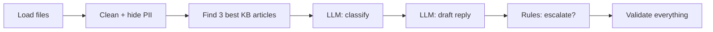

<p align="center"></p>

# Support Ticket Pipeline

> A robot helper that reads customer messages, finds the right help-article, writes a safe reply, and knows when to call a human.

**Status:** Stages 0–2 are closed (plan, foundations + PII masking, retrieval). Stage 3 (LLM client + classification) is next. See [Where are we?](#where-are-we) and the [plan](PLAN.md).

---

## The idea, for a 10-year-old

Imagine a toy shop with a help desk. Every day, kids and parents send letters:

- *"My toy was charged twice!"*
- *"I can't open my account!"*
- *"Where do I find my receipt?"*

One helper can't read thousands of letters. So we built a **robot assistant**. For every letter it does the same steps, in the same order:

| # | What the robot does | Like in real life |
|---|---|---|
| 1 | **Hides secrets** | Puts a sticker over phone numbers and card numbers so nobody sees them |
| 2 | **Looks up the rulebook** | Flips through the shop's help-book (the *knowledge base*) for the 3 best pages |
| 3 | **Sorts the letter** | Is it about money, logging in, something broken, or a question? How urgent? |
| 4 | **Writes a reply** | Using **only** facts from the help-book, in the customer's own language |
| 5 | **Decides: robot or human?** | Tricky or serious letters go to a person, with the reason written down |
| 6 | **Double-checks everything** | A strict checker makes sure the robot never lied, never promised a refund, and never asked for a password |

**The golden rules of the robot**

- 🤐 It never asks for your password.
- 💸 It never promises money back unless the rulebook says so.
- 📖 It never makes up facts. If it's not in the help-book, it says so or asks a human.
- 🕵️ It shows its work, so a person can see *why* it decided something.

---

## How it works (the grown-up version)

A batch command-line pipeline. It reads two files, `tickets.json` and `kb_articles.json`, and writes JSON "artifacts" for every ticket.



- **Computers decide the safe things, the LLM only does the language things.** Only *classification* and *drafting* call an AI model. Masking PII, searching, escalation, safety checks and validation are plain Python, so they give the same answer every time.
- **Order is enforced in code.** A stage machine refuses to run a step before the previous one finished.
- **AI output is never trusted blindly.** It is checked against allowed labels and safety rules, retried with feedback, then replaced by a safe template if it keeps failing.

Details: [SPEC.md](SPEC.md) (what it must do) · [DESIGN.md](DESIGN.md) (how and why) · [PLAN.md](PLAN.md) (how we build and audit it) · [PROBLEM.md](PROBLEM.md) (the original brief).

### What it produces

| File | What's inside |
|---|---|
| `retrieval_results.json` | The top 3 help-articles per ticket |
| `ticket_classification.json` | Category, urgency, what to do next |
| `draft_responses.json` | The reply and the articles it cites |
| `escalations.json` | Human needed? Which team? Why? |
| `validation_report.json` | The strict checker's verdict |
| `llm_calls.jsonl` | A log of every AI call (hashes, never raw customer data) |

---

## Where are we?

We build in **5 stages**. A stage is *closed* only after automatic checks pass **and** a human signs it off. Each closure is a git commit plus a tag (`stage-N-closed`).

| Stage | What | Status |
|---|---|---|
| 0 | Plan + test data | ✅ Closed (`stage-0-closed`) |
| 1 | Load, clean, hide PII, stage machine | ✅ Closed (`stage-1-closed`) |
| 2 | Retrieval | ✅ Closed (`stage-2-closed`) |
| 3 | LLM client + classification | 🚧 Next |
| 4 | Drafting, safety, escalation | ⬜ |
| 5 | Validation, replay, final report | ⬜ |

---

## Setup

You need **Python 3.11+** and (for real model runs) API keys.

```bash
git clone git@github.com:nadeemcite/support-ticket-pipeline.git
cd support-ticket-pipeline

python3 -m venv .venv
source .venv/bin/activate
pip install -r requirements.txt

cp .env.example .env                # if present; otherwise create .env and add the keys below
```

`.env` (never committed):

```bash
LLM_PROVIDER=ollama                 # ollama (default) | openai | stub
LLM_MODEL=glm-5.2
OLLAMA_API_KEY=...
OLLAMA_BASE_URL=...                 # OpenAI-compatible, ends with /v1
OPENAI_API_KEY=...                  # only for openai provider and evals
```

No keys? Use `LLM_PROVIDER=stub`, a built-in fake model that works offline and gives repeatable answers.

## Run

> `run_pipeline.py` exists and runs the stages built so far (it stops at the latest implemented stage, or earlier with `--until <STAGE>`). `validate.py` and the LLM stages arrive in Stages 3–5. Retrieval (Stage 2) already works offline.

```bash
python run_pipeline.py                      # full run on tickets.json + kb_articles.json
python run_pipeline.py --provider stub      # offline
python run_pipeline.py --tickets data/eval/tickets.json --kb data/eval/kb_articles.json --out-dir /tmp/out
python validate.py                          # re-check the artifacts on disk
```

Exit codes: `0` all good · `1` validation failures · `2` fatal error. All flags are in [SPEC §2](SPEC.md).

## Test

```bash
pytest -q                 # everything, offline, no network
pytest -m stage1          # one stage (markers stage1 … stage5)
pytest -m "not live"      # skip tests that call real models
```

Tests use the stub provider and the fixtures in [`data/`](data/README.md), so they are free and deterministic.

## Evals (comparing real models)

Evals run **offline, outside the pipeline**. Two models, `gpt-6.1-sol` and `deepseek-v4.1-flash`, process the same frozen inputs, get scored against the answer key in `data/eval/gold.json`, and **judge each other's drafts**. The model used for day-to-day work (`glm-5.2`) is never the grader.

```bash
python -m evals.retrieval_eval        # Stage 2, no LLM (available now)
python -m evals.classification_eval   # Stage 3
python -m evals.drafting_eval         # Stage 4
python -m evals.e2e_eval              # Stage 5
```

Reports land in `audit/stage-N/` and are committed. Gates and thresholds per stage: [PLAN.md](PLAN.md).

## Regenerate the banner

```bash
python scripts/generate_banner.py     # needs OPENAI_API_KEY; writes docs/assets/banner.png
```

## Project map

```text
pipeline/   the code (one module per stage)      data/    test + eval data (synthetic)
tests/      pytest suites                        evals/   offline model comparison
audit/      per-stage reports (committed)        docs/    images
PLAN.md SPEC.md DESIGN.md PROBLEM.md             AGENT.md for coding agents
```

## Working with a coding agent

Read [AGENT.md](AGENT.md). It lists the commands, rules and traps for AI coding assistants (and humans in a hurry).

## Privacy

All sample personal data is fake (`example.com` emails, test card `4111 1111 1111 1111`, example IBAN). Real customer text is masked before any model sees it.
